# Slint Learn

- author：syf20020816@outlook.com
- updateDate：20230902
- github：https://github.com/syf20020816/slint_learn
- video ：
  - 入门：https://www.bilibili.com/video/BV1r14y1k7T5/?spm_id_from=333.999.0.0&vd_source=9c2ae08297163e79152407c969f04717
  - 进阶：https://www.bilibili.com/video/BV1e14y1r7YV/?spm_id_from=333.999.0.0&vd_source=9c2ae08297163e79152407c969f04717
  - 项目：https://www.bilibili.com/video/BV14u411g7Xa/?spm_id_from=333.999.0.0&vd_source=9c2ae08297163e79152407c969f04717


# 如何学习本文档

## 学习顺序

本文档的学习顺序基本上就从上至下的，按照由前到后的顺序依次进行学习知道你遇到这个🚩标志，这个标志将引导你的学习顺序进行改变！

## 标志

- 🚩：说明学习顺序将发送改变（可能）或提示
- 👎：说明不建议使用

## 说明

本文档和官方文档是有一定的区别的，并不是翻译官方文档，官方文档中的内容可能会和本文档内容有一定的出入（名词解释、名词称呼、标记等），或许你可以在下表中找到对应。

| 官方 | 本文更名 |
| ---- | -------- |
| Builtin Elements | 普通组件 |
| color | Color.color |
| brush | Color.brush |
| physical-length | Length.phx |
| length | Length.size |
| relative-font-size | Length.rem |
| Builtin Elements | 普通组件 |
| Builtin Callbacks | 生命周期 |

# Slint With VSCode

我建议大家使用VSCode进行Slint开发，VSCode提供的插件对Slint十分友好，插件如下：

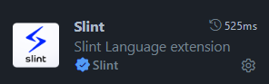

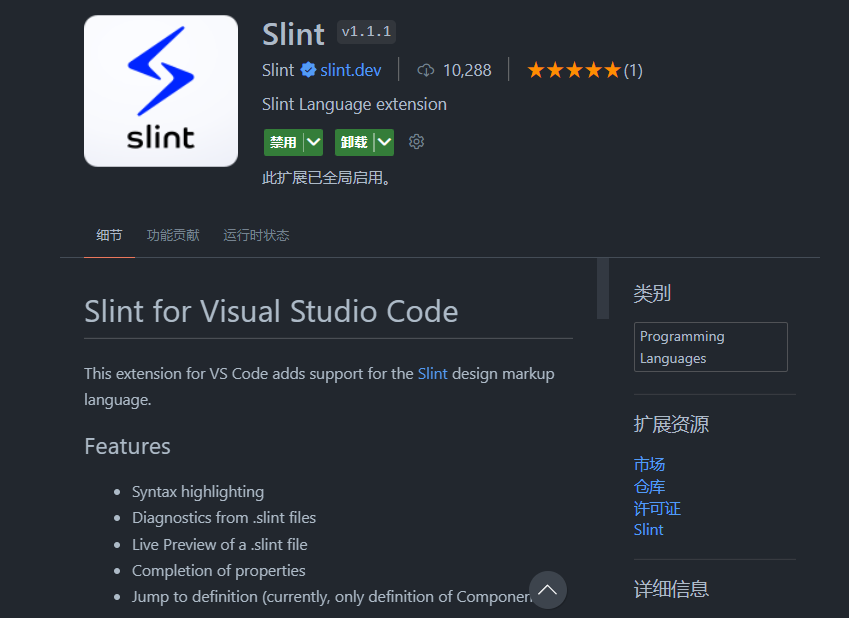

# Slint With Rust

## 依赖

```bash
cargo add slint
```

## 👎定义宏

用于定义一个组件，这样就可以再rs文件中进行书写

```
slint::slint!{}
```

# Slint与Rust分离

实际上更推荐更好的方式应该是slint文件于rs文件的分离

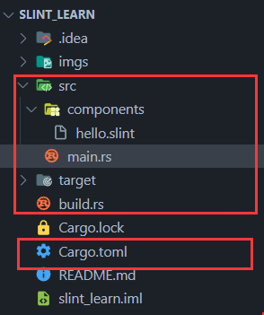

## 1.添加编译依赖（slint-build）

```toml
[package]
name = "slint_learn"
version = "0.1.0"
edition = "2021"

[dependencies]
slint = "1.1.1"

//添加编译依赖
[build-dependencies]
slint-build = "1.1.1"
```

## 2.编写slint文件

```slint
export component MainWindow inherits Window {
  Text{
    text: "Hello Slint";
  }
}
```

## 3.编写build.rs

```rust
fn main() {
  slint_build::compile("src/components/hello.slint").unwrap();
}
```

## 4.编写main.rs

```rust
//引入模块
slint::include_modules!();

fn main() {
    MainWindow::new().unwrap().run().unwrap();
}
```

# 普通组件

组件需要使用`componment`进行声明使用`export`进行导出

## 主窗体Window

窗体需要继承（inherits）Window

### example

```slint
export component MainWindow inherits Window {
  default-font-family: "Helvetica,Verdana,Arial,sans-serif";
  default-font-size: 16px;
  default-font-weight: 700;
  background: @linear-gradient(90deg,#ddd 0%,#ddc5c5 50%,#ed9797 100%);
  always-on-top: true;
  no-frame: false;
  icon: @image-url("../../imgs/rust.png");
  title: "Window!";
  height: 720px;
  width: 1200px;
}
```

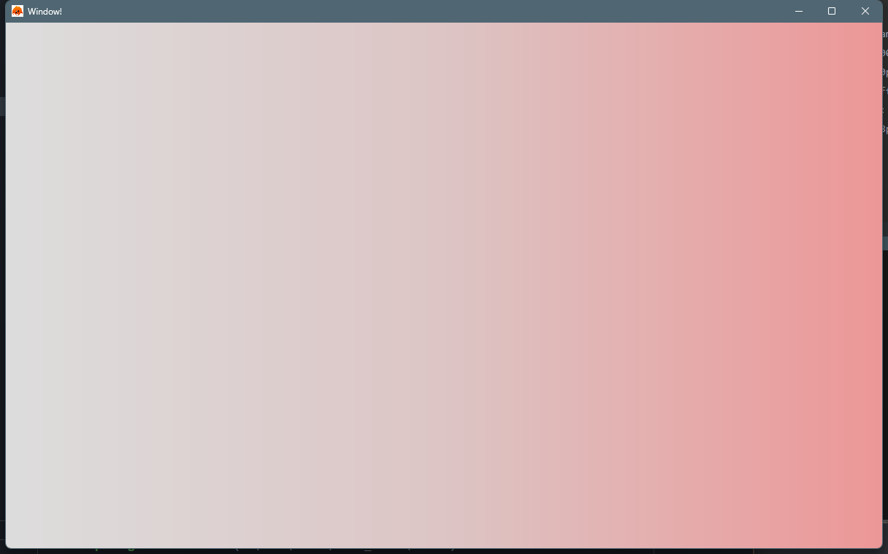

## 文本Text

### example

```
export component MainWindow inherits Window {
  height: 720px;
  width: 1080px;
  title: "Text!";
  Text {
    text: "I am a Text component";
    height: 200px;
    width: 100px;
    //文字换行
    wrap: word-wrap;
    color: #fff;
    font-size: 20px;
    padding: 8px;
    letter-spacing: 2px;
    //横向对齐
    horizontal-alignment:center;
    //纵向对齐
    vertical-alignment: center;
    overflow: elide;
  }  
}
```

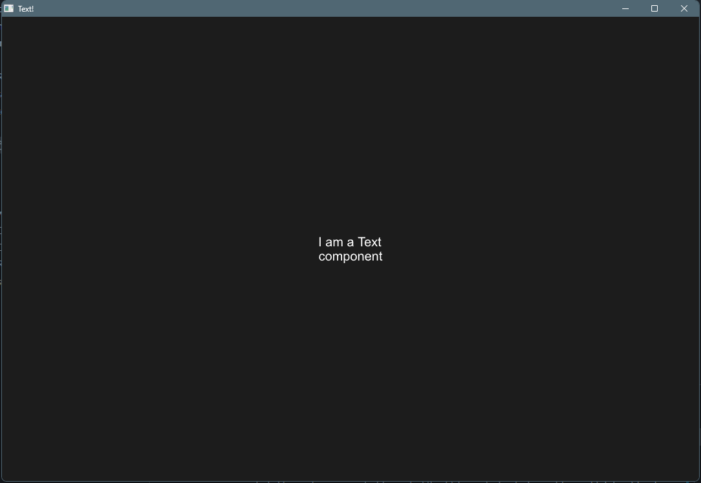

## 按钮Button

### example

```slint
import { Button } from "std-widgets.slint";
export component MainWindow inherits Window {
  height: 720px;
  width: 1200px;
  title: "Button!";
  Button { 
    height: 66px;
    width: 310px;
    icon: @image-url("../../imgs/rust.png");
    text: "I am a Button";
    clicked => {
      self.text = "Clicked!";
      self.width = 360px;
    }
  }
}
```

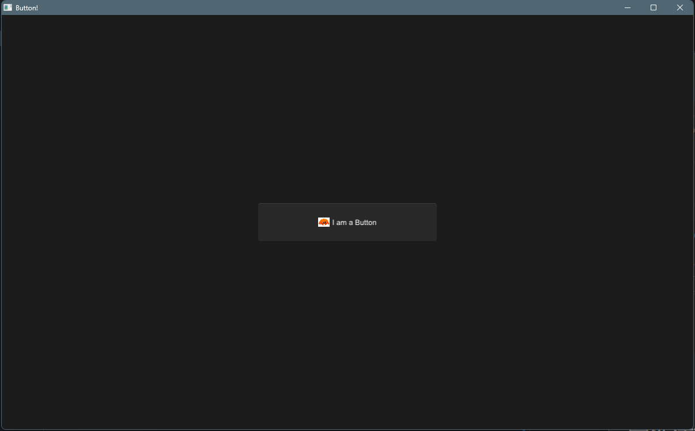

### functions

| 事件名  | 说明         |
| ------- | ------------ |
| clicked | 按钮点击事件 |

```
  Button { 
    height: 66px;
    width: 310px;
    text: "I am a Button";
    clicked => {
      self.text = "Clicked!";
      self.width = 360px;
    }
  }
```

## 矩形盒子元素 Rectangle

Rectangle只是一个不显示任何内容的空项。通过设置颜色或配置边框，可以在屏幕上绘制矩形。当不是布局的一部分时，其宽度和高度默认为父元素的100%。

### example

```
export component MainWindow inherits Window {
  height: 720px;
  width: 1200px;
  Rectangle {
    background: red;
    border-color: #ddd;
    border-radius: 4px;
    border-width: 2px;
    height: 60px;
    width: 120px;
    //like overflow clip表示超出容器是否显示
    clip: true;
    Rectangle {
      background: blue;
      border-color: #ddd;
      border-radius: 4px;
      border-width: 2px;
      height: 20px;
      width: 30px;
      x: 0px;
      y: 10px;
    }
    Rectangle {
      background: blue;
      border-color: #ddd;
      border-radius: 4px;
      border-width: 2px;
      height: 202px;
      width: 300px;
      x: 50px;
      y: 10px;
    }
  }
  Rectangle {
    background: blue;
    border-color: #ddd;
    border-radius: 4px;
    border-width: 2px;
    height: 202px;
    width: 300px;
    x: 50px;
    y: 10px;
  }
}
```

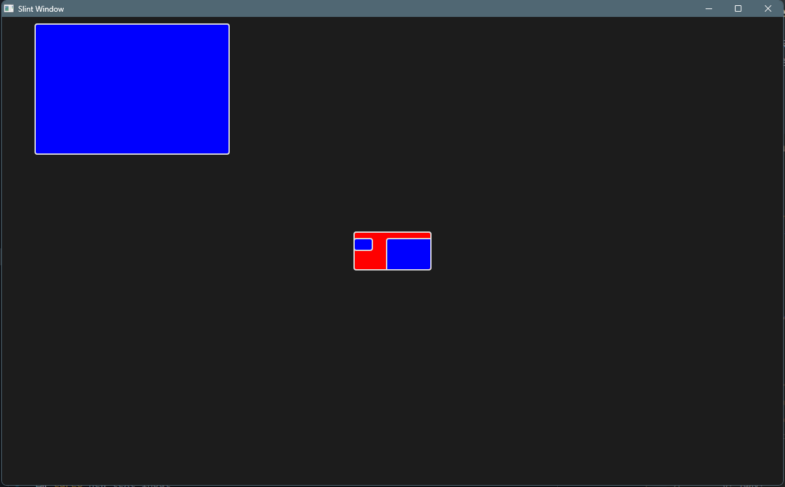

## 输入框TextInput

这是一种低级输入框，它将直接使用父级容器的宽高，无法自己设置

### example

```
export component MainWindow inherits Window {
  height: 720px;
  width: 1200px;
  title: "Text Input!";
  TextInput {
    color: burlywood;
    font-family: "Verdana";
    font-size: 18px;
    font-weight: 400;
    horizontal-alignment: left;
    input-type: text;
    read-only: false;
    selection-background-color: blue;
    selection-foreground-color: red;
    single-line: false;
    wrap: word-wrap;
    text: "default text";
    text-cursor-width:8px;
  }
}
```

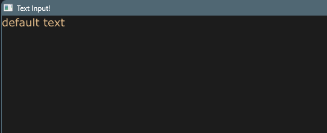

## 图片Image

### example

```
export component MainWindow inherits Window {
  height: 720px;
  width: 1200px;
  title: "Image!";
  Image {
    source: @image-url("../../imgs/rust.png");
    image-fit:fill;
    image-rendering: smooth;
    //设置旋转中心
    rotation-origin-x: 23px;
    rotation-origin-y: 56px;
    rotation-angle: 30deg;
    source-clip-height: 200;
    source-clip-x: 100;
    height: 300px;
  }
}
```

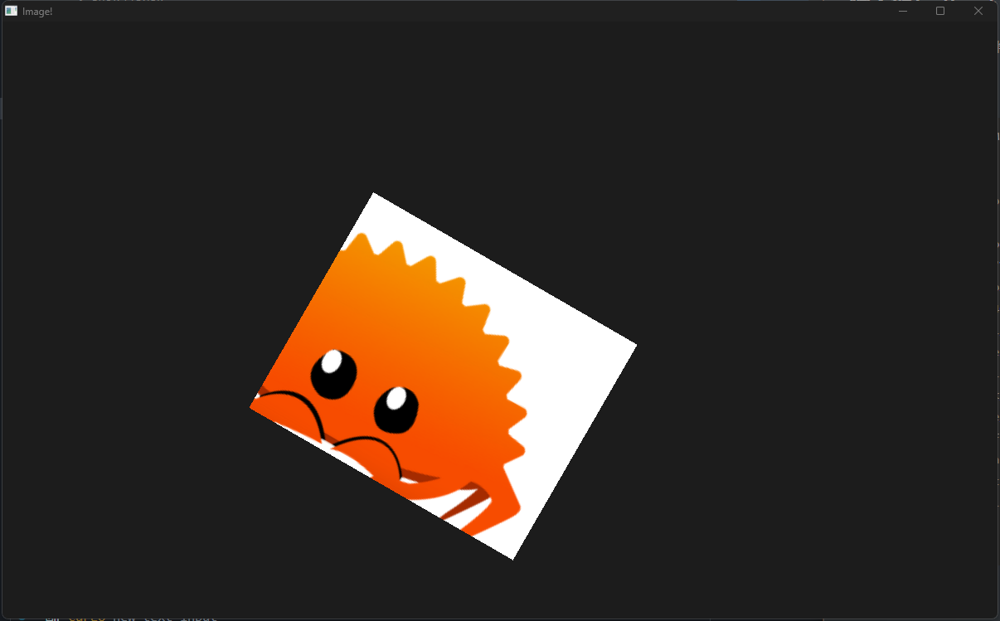

## 滚动窗口 Flickable

Flickable不是产生一个可滚动的窗口，而是给一个元素增加可滚动的容器。因为他是对于父容器而言，子容器可滚动，而不是使得父容器可滚动

### example

```
export component MainWindow inherits Dialog {
  height: 200px;
  width: 300px;
  title: "Flickable!";
  Flickable {
      interactive: true;
      viewport-height: 300px;
      viewport-width: 400px;
      viewport-x: 0px;
      viewport-y: 0px;
     Rectangle {
      height: 200px;
      width: 300px;
      background: #792121;
     }
  }
}
```

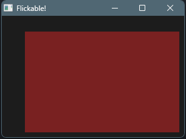

## 网格布局 GridLayout

使用网格布局下的元素会被添加

- col：所在列
- row：所在行
- colspan：列占比
- rowspan：行占比

这4个属性，通常使用这四个属性进行控制

也可以使用`Row{}`进行行声明将在同一行的元素全部放在一个Row下

> ❗值得注意的是：个人认为Slint的网格布局有一定的问题，期待在后续版本中修复 （列占比和所在列需要强指定，弱指定会导致推测错误）
>
> 问题如下：
>
> 这里的第二行的白色Rectangle列占比应该是2但是显示的却是1，经过叠放检查得出白色盒子的另一半被绿色覆盖，所以弱指定无法推测出绿色盒子实际上应该在第3列，需要手动指定`col:2`
>
> 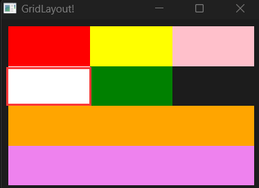

### example

```
export component MainWindow inherits Dialog {
  height: 200px;
  width: 300px;
  title: "GridLayout!";
  GridLayout {
    spacing: 10px;
    padding: 4px;
    //使用Row进行行声明
    Row{
      Rectangle { background: red; }
      Rectangle { background: yellow;}
      Rectangle { background: pink; }
    }
    Row{
      Rectangle { background: white; colspan: 2; }
      Rectangle { background: green; colspan: 1; col: 2;} 
    }
    Rectangle { background: violet; colspan: 3;row:3;}
    Rectangle { background: orange; colspan: 3;row:2;}
  }
}
```

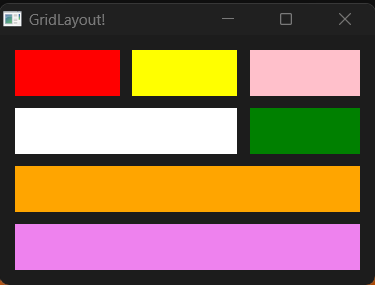

## 横纵布局 HorizontalLayout | VerticalLayout

通过alignment属性对元素排列方式进行控制。横纵布局常常组合使用相互配合

### HorizontalLayout

横向布局即元素全部排列在同一行

```
export component MainWindow inherits Window {
  height: 330px;
  width: 400px;
  title: "HorizontalLayout!";
  HorizontalLayout {
    spacing: 5px;
    padding: 6px;
    height: 100px;
    width: 400px;
    x: 0px;
    y: 0px;
    alignment: center;
    Rectangle {background: red;height: 30px;width: 50px;}
    Rectangle {background: green; height: 30px;width: 100px;}
    Rectangle {background: blue; height: 80px;width: 50px;}
  }
  HorizontalLayout {
    spacing: 5px;
    padding: 6px;
    height: 100px;
    width: parent.width;
    x: 0px;
    y: 110px;
    alignment: space-around;
    Rectangle {background: red;height: 30px;width: 50px;}
    Rectangle {background: green; height: 30px;width: 100px;}
    Rectangle {background: blue; height: 80px;width: 50px;}
  }
  HorizontalLayout {
    spacing: 5px;
    padding: 6px;
    height: 100px;
    width: parent.width;
    x: 0px;
    y: 220px;
    alignment: end;
    Rectangle {background: red;height: 30px;width: 50px;}
    Rectangle {background: green; height: 30px;width: 100px;}
    Rectangle {background: blue; height: 80px;width: 50px;}
  }
}
```

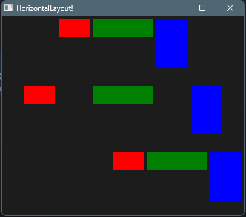

### VerticalLayout

```
export component MainWindow inherits Window {
  height: 200px;
  width: 480px;
  title: "HorizontalLayout!";
  VerticalLayout {
    spacing: 5px;
    padding: 6px;
    height: root.height;
    width: 150px;
    x: 0px;
    y: 0px;
    alignment: center;
    Rectangle {background: red;height: 30px;width: 50px;}
    Rectangle {background: green; height: 30px;width: 100px;}
    Rectangle {background: blue; height: 80px;width: 50px;}
  }
  VerticalLayout {
    spacing: 5px;
    padding: 6px;
    height: root.height;
    width: 150px;
    x: 160px;
    y: 0px;
    alignment: space-around;
    Rectangle {background: red;height: 30px;width: 50px;}
    Rectangle {background: green; height: 30px;width: 100px;}
    Rectangle {background: blue; height: 80px;width: 50px;}
  }
  VerticalLayout {
    spacing: 5px;
    padding: 6px;
    height: root.height;
    width: 150px;
    x: 320px;
    y: 0px;
    alignment: end;
    Rectangle {background: red;height: 30px;width: 50px;}
    Rectangle {background: green; height: 30px;width: 100px;}
    Rectangle {background: blue; height: 80px;width: 50px;}
  }
}
```

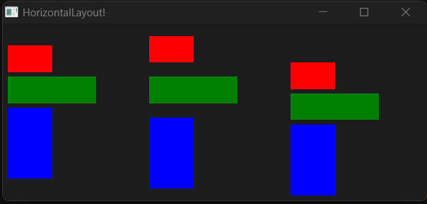

## 画板 Path

通过描边的方式绘制形状，我称之为画板

- 使用Slint的路径命令进行绘制
- 使用SVG的路径命令进行绘制

### SVG路径命令和Slint路径命令

**如果指令字母是大写的，例如M, 则表示坐标位置是绝对位置；如果指令字母小写的，例如m, 则表示坐标位置是相对位置。**

使用`commands`属性进行声明（下面以函数形式书写帮助理解）：

```
commands:"M ..."
```

- `M(x:float,y:float)`： `MoveTo` 表示这是一个新的起点，将关闭上一个绘图。例子：`M 0 100`
- `L(x:float,y:float)`：`LineTo` 表示从上一个点到当前点，这将绘制一条直线段。例子：`L 100 100`
- `A(radius_x:float,radius_y:float,large_arc:bool,sweep:bool,x_rotation:float,x:float,y:float)`: `ArcTo`
  - radius_x : 内切椭圆横长半径
  - radius_y : 内切椭圆纵长半径
  - 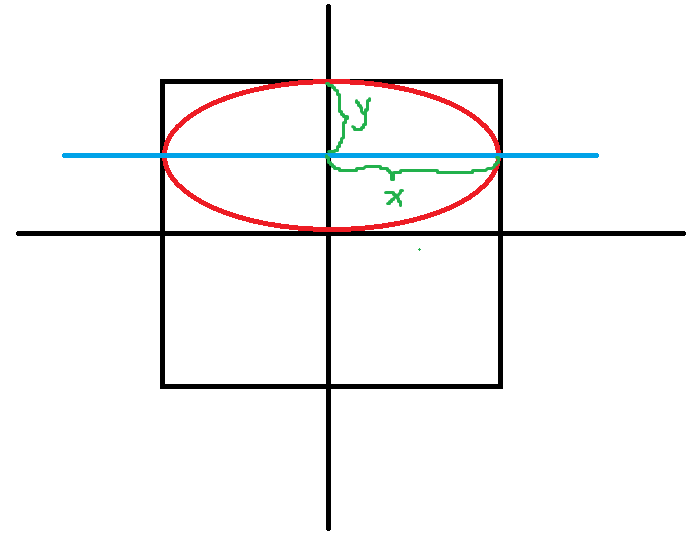
  - large_arc：在封闭椭圆的两个弧中，此标志选择要渲染较大的弧。如果属性为false，则会呈现较短的弧度
  - sweep：绘制顺时针或逆时针方向（true为顺时针）
  - x_rotation：内切椭圆按照x轴旋转的度数
- `C(control_1_x:float,control_1_y:float,control_2_x:float,control_2_y:float,x:float,y:float)`:`CubicTo`,光滑贝塞尔曲线
  - control_1_x：一号控制点的横坐标，后面也一样，这里不全写了
- `Q(control_x:float,control_y:float,x:float,y:float)`：`QuadraticTo`二次贝塞尔曲线
- `Z()`：`Close`关闭当前子路径，从当前位置到起点进行连线

### example

```
export component MainWindow inherits Window {
  height: 200px;
  width: 480px;
  title: "Path!";
  Path {
    width: 100px;
    height: 100px;
    x: 50px;
    y: 50px;
    commands: "M 0 0 L 0 100 A 1 1 0 0 0 100 100 L 100 0 Z";
    stroke: red;
    stroke-width: 1px;
  }
  Path {
    width: 100px;
    height: 100px;
    stroke: blue;
    stroke-width: 1px;
    x: 250px;
    y: 50px;
    MoveTo {
      x: 0;
      y: 0;
    }
    LineTo{
      x: 0;
      y: 100;
    }
    ArcTo {
      radius-x: 1;
      radius-y: 1;
      x: 100;
      y: 100;
    }
    LineTo {
      x: 100;
      y: 0;
    }
    Close {
    }
  }
}
```

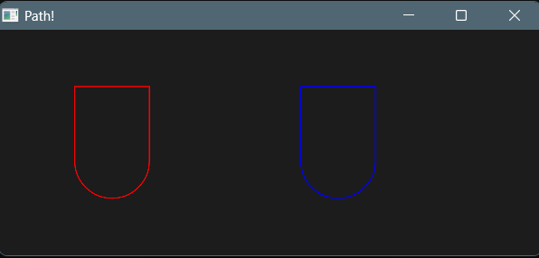

## 🚩Flag

**当你看到这里的时候，说明你已经把入门篇结束了，接下来为了你可以更好的理解高级组件，请移步到基础知识，学习完基础知识后进行高级组件学习！**

# 基础知识

当你看到这里的时候说明普通组件已经掌握，为了让你无障碍学习高级组件等后续知识请耐心学习基础知识，基础知识中有些名词经过我的修改并非和翻译出的名词名称一致，若发现一个你无法理解的名词请查询说明表。

## Slint文件编写顺序与结构

slint文件的编写顺序同js，是从上到下的，这意味着在下方块中的组件需要在上方块中进行定义才能使用（自定义组件），因此下面的代码是错误的！

```
import { Button } from "std-widgets.slint";
export component MainWindow inherits Window {
  MyButton{
    height: 50px;
    width: 50px;
  }
}

component MyButton inherits Button { 
  text: "My Button";
}
```

### 正确的代码

只需要将MyButton的声明移动到前面即可

```
import { Button } from "std-widgets.slint";

component MyButton inherits Button { 
  text: "My Button";
}

export component MainWindow inherits Window {
  MyButton{
    height: 50px;
    width: 50px;
  }
}

```

### Slint组件结构

slint的组件结构为树形结构，每个slint文件都可以定义一个或多个组件

## 组件的访问与命名

### 组件的访问

知道组件的结构为树形结构后，显而易见的，我们可以通过树进行组件层级访问，slint显然考虑到了这点，因此在slint中按照以下方式进行组件的层级访问：

1. `root`：树根组件，也就是组件的最外层组件，是所有子组件的根
2. `self`：当前组件，通过self可以直接访问当前自己的所有属性以及方法
3. `parent`：当前组件的父组件

### 标识符（命名规范）

和多数其他语言规范相同，由`(a~z),(A~Z),(0~9),(_,-)`组成，不能以数字或`-`开头，对于slint，`_ 和 -`在非开头位置起到规范化名称相同，意思是：`my_button == my-button`

### 命名组件

通过使用`:=`对组件进行命名，以此获取组件的引用！

```slint
export component MainWindow inherits Window {
  height: 300px;
  width: 300px;
  text1:=Text {
    text: "Hello" + num;
  }
}
```

## 注释

- `//` ： 单行注释
- `/* ..*/` ：多行注释

## Slint中的类型

> ❗注意：类型中我进行了些许的修改

| 类型        | 说明                                                         | 默认值      |
| ----------- | ------------------------------------------------------------ | ----------- |
| int         | 有符号整数                                                   | 0           |
| float       | 有符号32位浮点数（f32）                                      | 0           |
| bool        | 布尔值                                                       | false       |
| string      | 字符串                                                       | ""          |
| Color.color | RGB颜色，带有Alpha通道，每个通道的精度为8位，也可以是16进制色 | transparent |
| Color.brush | 特殊的颜色，可以从基础色进行渐变或更改，使用的更加广泛       | transparent |
| Length.phx  | 用于进行单位转换的量，长度 = 整数 * 1phx                     | 0phx        |
| Length.size | 常用长度单位，分为`px,pt,in,mm,cm`(`pt：1/72英寸`,`in(英寸):2.54cm`) | 0px         |
| Length.rem  | 跟组件字体大小单位                                           | 0rem        |
| duration    | 时间单位，用在动画上，分为：`ms,s`                           | 0ms         |
| angle       | 角度单位，多用于旋转，渐变。分为：`deg,rad,turn`（`1turn = 360deg = 2Πrad`） | 0deg        |
| easing      | 动画速率，分为：`ease,ease_in,ease_in_out,ease_out，linear)`就是常说的缓入缓出，线性 | linear      |
| image       | 图像，使用`@image-url()`                                     | 空图像      |
| percent     | 带有`%`的百分数                                              | 0%          |

### 颜色

普通颜色Color.color和特殊颜色Color.brush是有区别的，brush使用画笔填充元素或画出轮廓。而且brush多了一些方法：

- **`brighter(factor: float) -> brush`**

  返回从此颜色派生的新颜色，但其亮度增加了指定的系数。 例如，如果因子是0.5（或例如50%），则返回的颜色明亮50%。负面因素 降低亮度。

- **`darker(factor: float) -> brush`**

  返回从该颜色派生的新颜色，但其亮度已按指定因子降低。 例如，如果因子是.5（或例如50%），则返回的颜色是50%更暗。负面因素 增加亮度。

- **`mix(other: brush, factor: float) -> brush`**

  返回一个新颜色，它是此颜色和`other`，有比例 因子由一个因子给出（该因子将被限制在`0.0` 和`1.0`）.

- **`transparentize(factor: float) -> brush`**

  返回一个新的颜色，其不透明度减少了`factor`. 透明度是通过将alpha通道乘以`(1 - factor)`.

- **`with_alpha(alpha: float) -> brush`**

  返回alpha值设置为`alpha` （介于0和1之间）

#### 线性渐变

```
//语法：
@linear-gradient(渐变角度, 颜色 占比, 颜色 占比, ...);

@linear-gradient(90deg, #3f87a6 0%, #ebf8e1 50%, #f69d3c 100%);
```

#### 径向渐变

```
//语法
@radial-gradient(circle, 颜色 占比, 颜色 占比, ...);

@radial-gradient(circle, #f00 0%, #0f0 50%, #00f 100%);
```

### 🚩Flag

在学习自定义类型前请先移步属性进行学习，这将有利于你对自定义属性的理解

## 自定义类型

### 结构体

通过自定义结构体就能声明复杂的类型，这通常来说并不能再称之为属性，而是内部数据！（按照作用）但在本文还是称为属性，但请严格进行辨别。

```slint
struct User {
  name:string,
  age:int,
}

export component MainWindow inherits Window {
  height: 300px;
  width: 300px;
  Text {
    property <User> user:{name:"I am Mat",age:16};
    text: user.name;
  }
}
```

### 匿名结构体

匿名结构体指的是直接在进行声明而不再外部设置名称的无法被复用的结构体

```
export component MainWindow inherits Window {
  height: 300px;
  width: 300px;
  Text {
    property <{name:string,age:int}> user:{name:"I am Mat",age:16};
    text: user.name;
  }
}
```

### 枚举

```
enum CompoentType{
  System,
  Define
}


export component MainWindow inherits Window {
  height: 300px;
  width: 300px;
  Text {
    property <CompoentType> type : CompoentType.System ;
    text: type == CompoentType.System?"Sys":"Define";
  }
}
```

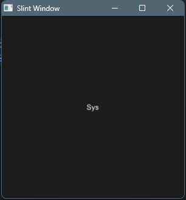

### 数组

数组的声明非常简单`[数据类型]`即可，其访问也是使用`[索引]`进行访问

```
export component MainWindow inherits Window {
  height: 300px;
  width: 300px;
  property <[color]> colors:[#fff,#dc3b3b,#eee] ;
  background: colors[1];
}
```

## 属性

所有组件都有属性，属性是组件的重要组成部分，属性有默认的也有自定义的，属性有四种访问等级，对应其可见性。

### 属性可见性

- **`private`** ：只能从组件内部访问，它是默认的
- **`in`**：属性是输入。它可以由该组件的用户设置和修改， 例如通过绑定或通过回调中的分配。 组件可以提供默认绑定，但不能对其进行分配
- **`out`**：只能由组件设置的输出属性，可以被外部获取
- **`in-out`**：公开读写的属性

### 自定义属性

```
export component MainWindow inherits Window {
  in property <int> num1;
  in-out property <int> num2;
  out property <int> num3;
  // property <int> num4
  private property <int> num4;
}
```

### 属性赋值（属性的单向绑定）

通过直接在声明的属性后设置值即为属性默认值，同时也代表对属性进行了单向绑定

```
export component MainWindow inherits Window {
  in property <int> counter : 10;
}
```

### 属性的双向绑定

属性的双向绑定能够响应式的修改属性，通过使用`<=>`起到双向绑定的效果

#### private属性访问

通过结合双向绑定和组件命名private属性也是可以被访问的

```
import { Button } from "std-widgets.slint";
export component MainWindow inherits Window {
  height: 300px;
  width: 300px;
  property <int> root-num <=> text1.num;
  title: root-num;
  text1:=Text {
    x: 0px;
    y: 0px;
    property <int> num : 10;
    text: "Hello" + num;
  }
  Button { 
    text: "click here!";
    clicked => {
      parent.root-num +=2;
    }
  }
}
```

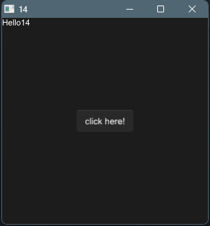

## 函数与回调

### 函数

我们可以在组件中定义一些函数帮助组件进行工作，对于函数而言，它在组件内进行定义，在 Slint 中，如果一个函数在组件的属性定义中被调用，它必须是纯函数，即给定相同的输入参数，始终返回相同的结果。纯函数需要使用`pure`关键字进行声明，纯函数也被称为一种回调（我这样认为）。

```
export component MainWindow inherits Window {
  height: 300px;
  width: 300px;
  title: text.get-name();
  text:=Text {
    text: "I am Text";
    property<string> name : "text";
    pure public function get_name()-> string {
      self.name;
    }
  }
}
```

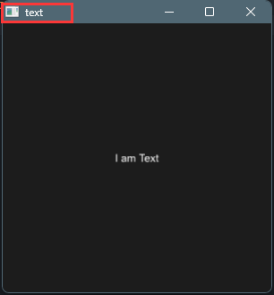

### 回调

组件可以声明回调，用来传递状态的变化到组件外。

对于回调我们通常需要经过2个步骤进行定义：

- 声明回调：使用`callback`关键字进行声明
- 编写回调：使用箭头函数进行声明

回调是特殊的函数，因此回调也可以有入参和返回值，请在回调声明时进行控制

```slint
import { Button } from "std-widgets.slint";
component MyBtn inherits Text{
  in-out property <int> num:0;
  callback click;
  click => {
    self.num += 1;
  }
}

export component MainWindow inherits Window {
  height: 300px;
  width: 300px;
  Button { 
    text: "add 1";
    clicked => {
      btn.click()
    }
  }
  btn:=MyBtn {
    x: 10px;
    y: 10px;
    font-size: 20px;
    text: self.num;
  }
}
```

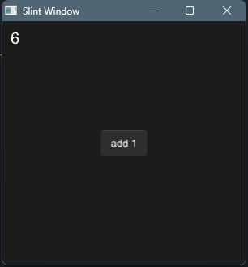

#### 回调别名

回调也可以有别名，可以使用双向绑定的方式设置回调别名

```
export component Example inherits Rectangle {
    callback clicked <=> area.clicked;
    area := TouchArea {}
}
```

## 条件于循环

### 条件

在slint中条件语句的构造和其他语言一样都是`if - else if - else`

```
if(条件){}
else if (条件){}
else{}
```

当然条件也可以使用在构造组件上，用于判断组件状态

```
if 条件 : 组件
```

### 三元表达式

通过三元表达式可以做到条件语句的功能

```
条件?匹配成功返回值:失败的返回值
```

### 循环

通过使用循环可以做到组件复制，其中item是循环对象的中的某个元素（顺序），`[index]`当前item的索引，个人认为这样的语法较为不妥，我更喜欢如：`for (item,index) in `这种

```
for item[index] in 循环对象
```

#### example

```
export component MainWindow inherits Window {
  height: 300px;
  width: 300px;
  property <[color]> colors : [#ff9d9d,#fff,#c4c4c4,#111,#444] ;
  for color[index] in colors:  Rectangle {
    height: root.height;
    width: root.width / colors.length;
    x:self.width *  index; 
    background: color; 
  }
}
```

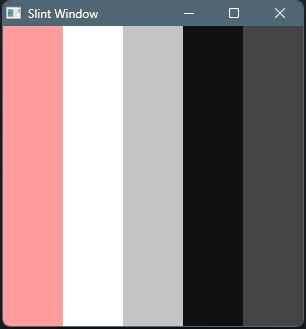

## 动画

通过`animate`进行定义动画，动画中需要定义的参数如下：

- `delay`：开始动画之前等待的时间量
- `duration`：动画完成所需的时间
- `iteration-count`：动画应运行的次数。负值指定动画无限重播
- `easing`：动画速率，可以`linear`、`ease`、`ease-in`、`ease-out`、`ease-in-out`、`cubic-bezier(a, b, c, d)`

```
export component MainWindow inherits Window {
  width: 300px;
  height: 300px;
  background: area.pressed ? #fff : red;
  animate background {
      duration: 100ms;
  }

  area := TouchArea {
    
  }
}
```

## 🚩Flag

当你看到这里时，说明大部分的基础知识已经掌握，请移步至高级组件进行学习直到下个Flag

# 高级知识

## 状态

对于组件来说，可以声明多种状态，每种状态的判断规则不同，状态需要使用`states[]`进行声明，具体语法：

```
states[
	状态1 when 条件{}
	状态2 when 条件{}
	...
]
```

### example

```
export component MainWindow inherits Window {
  width: 300px;
  height: 300px;
  default-font-size: 24px;
  property <bool> active: true;
  label := Text { }
  area := TouchArea {
      clicked => {
          active = !active;
      }
  }
  
  states [
    //声明active-click状态
      active-click when active && !area.has-hover: {
          label.text: "Active";
          root.background: blue;
      }
      //声明active-hover状态
      active-hover when active && area.has-hover: {
          label.text: "Active Hover";
          root.background: green;
      }
      //声明clicked状态
      clicked when !active: {
          label.text: "Clicked";
          label.color:#000;
          root.background: #fff;
      }
  ]
}
```

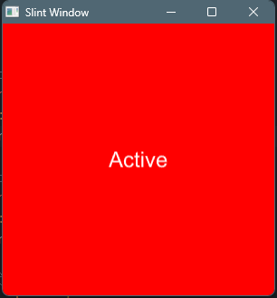

### 通过状态更改动画

这里修改了一下官方的案例，给出两个状态disabled和down，通过使用out 和in关键字向往或内的对动画进行改变，其中*表示通配符（所有）

```
export component AnStates inherits Window {
  width: 100px;
  height: 100px;

  text := Text { text: "hello"; }
  in-out property<bool> pressed;
  in-out property<bool> is-enabled;
  TouchArea {
    clicked => {
      root.is-enabled = !root.is-enabled;
      root.pressed = !root.pressed
    }
  }
  states [
      disabled when !root.is-enabled : {
          background: gray; // same as root.background: gray;
          text.color: white;
          out {
              animate * { duration: 800ms; }
          }
      }
      down when pressed : {
          background: blue;
          in {
              animate background { duration: 300ms; }
          }
      }
  ]
}
```

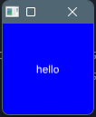

## 👎插槽

插槽的用处是可以在组件的某个部位插入所需要的子组件，在slint中使用`@children`进行指定插入位置

```slint
component MyComponent inherits HorizontalLayout {
  height: 300px;
  width: 300px;
  Rectangle {height: 50px;width: 50px;background: red;}
  @children
  Text {
    text: "I am a Text";
  }
}

export component MainWindow inherits Window {
  width: 300px;
  height: 300px;
  
  MyComponent {
    Rectangle {height: 50px;width: 50px;background: blue;}
  }
}
```

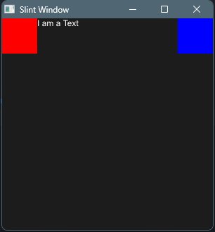

## 模块的导入和导出

导入和导出的作用是为了让组件或数据能够更好的复用，因此我们知道这几个关键字：

1. global：全局变量
2. export：导出
3. import：导入
4. from：文件地址

### 全局变量

要让一个属性或结构体或枚举在全局中都可以使用则需要使用`global`关键字进行定义，这样就能在整个项目中使用了

```
global MyColors {
  in-out property <color> red : #e24949;
  in-out property <color> green : #6de249;
  in-out property <color> blue : #4989e2;
}

export component MainWindow inherits Window {
  width: 300px;
  height: 300px;
  background: MyColors.green;
  
}

export { 
  MyColors
}
```

### 导出

导出的关键字`export`导出的方式有以下几种：

1. `export{...}`	：导出内容，可进行选择
2. `export component ...`：导出单个	
3. `export * from "slint file address"`：导出所有

#### 导出重命名

导出时可以使用`as`关键字对导出项进行重命名

```
export {MyColors as DefaultColors};
```

### 导入

使用`import`关键字联合`from`进行导入模块文件

```
 import {MyColors} from "./colors.slint";
```

### example

```
import { MyColors } from "./14_global.slint";


component Example inherits Window {
  height: 100px;
  width: 100px;
  background: MyColors.red;
}
```

## 🚩Flag

当你看到这个标记时请移步至生命周期

# 高级组件

## 触碰事件区域 TouchArea 

使用TouchArea来控制当它覆盖的区域被触摸或使用鼠标交互时会发生什么。当不是布局的一部分时，其宽度或高度默认为父元素的100%

### example

```
export component Example inherits Window {
  width: 200px;
  height: 100px;
  background: area.pressed?red:blue;
  area := TouchArea {
      width: parent.width;
      height: parent.height;
      clicked => {
          root.background = #777
      }
      
  }
}

```

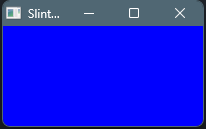

### functions

- clicked()：单击时调用，按下鼠标，然后释放此元素。
- moved()：鼠标已被移动。只有在按下鼠标时才会调用。
- pointer-event(PointerEvent)：按下或松开按钮时调用。

#### `PointerEvent`

表示指针由窗口系统发送的事件。 生成此结构并将其传递给`pointer-event` 的回调`TouchArea` 元素

- **`button`** （*PointerEventButton*）：按下或释放的按钮
- **`kind`** （**PointerEventKind**）：按钮类型
- **`modifiers`** （*KeyboardModifiers*）：事件期间按下的键盘修饰符

#### `PointerEventButton`

此枚举描述指针事件的不同类型的按钮， 通常在鼠标

- **`other`**：一个不是左、右或中间的按钮。例如 这用于具有许多按钮的鼠标上的第四个按钮。
- **`left`**：左按钮。
- **`right`**正确的按钮。
- **`middle`**：中心按钮。

#### `PointerEventKind`

枚举报告发生在`PointerEventButton` 

- **`cancel`**：操作已取消。
- **`down`**：按钮被按下了。
- **`up`**：按钮被释放。


## FocusScope

FocusScope暴露了回调以拦截关键事件。请注意，FocusScope只会在has-focus时调用它们。

KeyEvent有一个文本属性，这是输入的密钥的字符。当按下不可打印的键时，该字符要么是控制字符，要么被映射到私有Unicode字符。这些不可打印的特殊字符的映射在Key命名空间中可用

### example

```
export component MainWindow inherits Window {
  width: 300px;
  height: 300px;
  text1:=Text {

  }
  text2:=Text{
    y:100px;
  }
  FocusScope {
    property <int> press:0;
    property <int> release:0;
    TextInput {}
    key-pressed(e) => {
      press+=1;
      text1.text = "key pressed" + press;
      accept
    }
    key-released(e) => {
      release+=1;
      text2.text = "key released" +release;
      accept
    }
  }
  
}
```

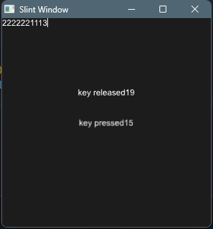

### functions

- key-pressed(KeyEvent) -> EventResult：按下键时调用，参数是KeyEvent结构。（只有输入KeyboardModifiers中4种键才调用）
- key-released(KeyEvent) -> EventResult：在释放密钥时调用，参数是KeyEvent结构。（任意输入时都调用）
   示例

####  KeyEvent

此结构被生成并传递给FocusScope元素的按键按下和释放回调。包含字段：

- text（字符串）：键的字符串表示
- modifiers（KeyboardModifiers）：事件期间按下的键盘修饰符

#### EventResult

此枚举描述了事件是否被事件处理程序拒绝或接受。

- reject：事件被此事件处理程序拒绝，然后可能由父项处理
- accept：该活动已被接受，将不再进一步处理

#### KeyboardModifiers

此结构作为KeyEvent的一部分生成，以指示在生成密钥事件期间按下了哪些修饰键。包含字段:

- control（bool）：如果按下控制键，则true。在macOS上，这与命令键相对应。
- alt（bool）：如果按下alt键，则true。
- shift（bool）：如果按下Shift键，则true。
- meta（bool）：如果在Windows上按下Windows键，或在macOS上按下控制键，则true。

## 弹出框 PopupWindow 

一种低级的弹出框，无法从外部访问弹出框中的组件

通过`show`方法显示弹窗

### example

```
import { Button } from "std-widgets.slint";
export component MainWindow inherits Window {
  width: 300px;
  height: 300px;
  popup := PopupWindow {
    Text {
      text: "I am Popup";
    }
    x: 20px;
    y: 20px;
    height: 50px;
    width: 50px;
  }

  Button { 
    text: "Show Popup";
    clicked => {
      popup.show()
    }
  } 
}
```

### functions

- show：显示弹窗

## Dialog 对话框

一种对话框，你可能觉得它和弹出框很像，但对话框被限定了，对话框可以具有任意数量的`StandardButton`或其他具有`dialog-button-role`属性的按钮。

```
import { Button , StandardButton} from "std-widgets.slint";
export component MainWindow inherits Dialog {
  height: 720px;
  width: 1200px;
  title: "Dialog!";
  icon: @image-url("../../imgs/rust.png");
  //主元素
  Text {
    font-size: 30px;
    text: "This is a dialog";
  }
  StandardButton { 
    kind: ok;
  }
  StandardButton { 
    kind: cancel;
  }
  Button {
    width: 120px;
    text: "info";
    // 假扮成dialog-button元素
    dialog-button-role: action;
  }
}
```

## 生命周期

每一个组件都有一个init初始化生命周期，表示组件被初始化（渲染）时激活

```
init => {//init...}
```

# 属性速查

## 常用

### 高度 height

```
height: 200px;
```

### 宽度 width

```
width:200px;
```

### 位置 x和y

元素相对于其父元素的位置

```
x:20px;
```

### 叠放等级 z

元素在同一级元素中的堆叠次序，默认值为0

```
z:1111;
```

### 网格布局 col，row， colspan，rowspan

```
Rectangle { background: green; colspan: 1; col: 2;} 
```

### 拉伸 horizontal-stretch和vertical-stretch

```
horizontal-stretch: 2;
```

### 元素的最大大小 max-width和max-height

```
max-width:1000px;
```

### 元素的最小大小 min-width和min-height

```
min-width:120px;
```

### 元素的首选尺寸 preferred-width和preferred-height

```
preferred-height:100px;
```

### 是否显示 visible

可见性，默认true

```
visible:false;
```

### 透明度 opacity

默认值为1（0是完全透明的，1是完全不透明的）

```
opacity:0.5;
```

### 加速渲染 cache-rendering-hint 👎

默认false

### 阴影半径 drop-shadow-blur

阴影的模糊程度，默认值为0

```
 drop-shadow-blur：2;
```

### 阴影颜色 drop-shadow-color

### 阴影位置 drop-shadow-offset-x和drop-shadow-offset-y

阴影与元素框架的水平和垂直距离，若为负值，阴影位于元素的左边和上方

```
drop-shadow-offset-x：2px;
```

## 窗口属性Window Params

| 属性                | 说明（类型）                 | 示例                                                         |
| ------------------- | ---------------------------- | ------------------------------------------------------------ |
| default-font-family | 默认文字类型（String）       | default-font-family: "Helvetica,Verdana,Arial,sans-serif";   |
| default-font-size   | 默认文字大小(Size)           | default-font-size: 16px;                                     |
| default-font-weight | 默认文字粗细（Int）          | default-font-weight:700                                      |
| background          | 背景(Color.brush)            | background: @linear-gradient(90deg,#ddd 0%,#ddc5c5 50%,#ed9797 100%); |
| always-on-top       | 永远处于其他页面上层（Bool） | always-on-top: true;                                         |
| no-frame            | 无边框，默认false（Bool）    | no-frame: false;                                             |
| icon                | 窗口图标（Image）            | icon: @image-url("../../imgs/rust.png");                     |
| title               | 窗口标题（String）           | title: "Window!";                                            |

## 文字属性Text Params

| 属性                 | 说明（类型）                        | 示例                                                       |
| -------------------- | ----------------------------------- | ---------------------------------------------------------- |
| horizontal-alignment | 横向对齐（TextHorizontalAlignment） | default-font-family: "Helvetica,Verdana,Arial,sans-serif"; |
| vertical-alignment   | 纵向对齐（TextVerticalAlignment）   | default-font-size: 16px;                                   |
| wrap                 | 文字换行（TextWrap）                | default-font-weight:700                                    |
| overflow             | 文字超出策略（TextOverflow）        | overflow: elide;                                           |
| font-size            | 文字大小（Length.size）             | font-size: 20px;                                           |
| color                | 文字颜色（Color.color）             | color: #fff;                                               |
| font-weight          | 文字粗细(Int)                       | font-weight:700;                                           |
| letter-spacing       | 文字间隔大小（Length.size）         | letter-spacing:2px;                                        |
| text                 | 文字内容（String）                  | text: "I am a Text component";                             |

### TextOverflow

此枚举描述了如果文本太宽而无法适应Text宽度，文本的显示方式。

- clip：文本将被简单地剪切。
- elide：文本将被省略为…

### TextHorizontalAlignment

此枚举描述了文本沿Text元素水平轴对齐的不同类型的内容。

- left：文本将与包含框的左边缘对齐。
- center：文本将在包含框中水平居中。
- right：文本将排列在包含框的右侧。

###  TextVerticalAlignment

此枚举描述了文本沿Text元素垂直轴对齐的不同类型的内容。

- top：文本将与包含框的顶部对齐。
- center：文本将垂直居中于包含框中。
- bottom：文本将与包含框的底部对齐。

###  TextWrap

此枚举描述了文本太宽而无法适应Text宽度时如何包装。

- no-wrap：文本不会包装，而是会溢出。
- word-wrap：文本将以单词边界包装。

## 输入框属性Textnput Params

含有文字属性（Text Param）

| 属性                       | 说明（类型）                 | 示例                              |
| -------------------------- | ---------------------------- | --------------------------------- |
| input-type                 | 输入框类型（InputType）      | input-type: text;                 |
| read-only                  | 是否只读（Bool）             | read-only: false;                 |
| selection-background-color | 输入时文字的背景色（Color）  | selection-background-color: blue; |
| selection-foreground-color | 输入时文字的颜色（Color）    | selection-foreground-color: red;  |
| single-line                | 是否为单行，即不换行（Bool） | single-line: false;               |
| text-cursor-width          | 光标的宽度（Length.size）    | text-cursor-width:8px;            |

###  InputType

此枚举用于定义输入字段的类型。目前，这只能区分文本和密码输入，但将来可以扩展它，以定义应该显示哪种类型的虚拟键盘，例如。

- text：默认值。这将正常呈现所有字符
- password：这将呈现所有字符，其字符默认为`*`

## 图片属性 Image Params

| 属性                                  | 说明（类型）                      | 示例                                       |
| ------------------------------------- | --------------------------------- | ------------------------------------------ |
| colorize                              | 覆盖前景色（Color）               | colorize:Colors.aliceblue;                 |
| source                                | 图像源（Image）                   | source: @image-url("../../imgs/rust.png"); |
| image-fit                             | 图片填充类型（ImageFit）          | image-fit:fill;                            |
| image-rendering                       | 图片缩放方式（ImageRendering）    | image-rendering: smooth;                   |
| rotation-origin-x，rotation-origin-y  | 设置旋转中心的位置（Length.size） | rotation-origin-x: 23px;                   |
| rotation-angle                        | 旋转角度（angle）                 | rotation-angle: 30deg;                     |
| source-clip-height，source-clip-width | 裁剪高度/|宽度（Length.size）     | source-clip-height: 200;                   |
| source-clip-x，source-clip-y          | 裁剪位置（Length.size）           | source-clip-x: 100;                        |

### ImageFit

该枚举定义了源图像如何融入Image元素。

- fill：缩放和拉伸源图像，以适应Image元素的宽度和高度。
- contain：源图像被缩放以适应Image元素的尺寸，同时保留宽高比。
- cover：源图像被缩放以覆盖到Image元素的尺寸，同时保留宽高比。如果源图像的宽高比与元素的宽高比不匹配，那么图像将被裁剪以适合。

### ImageRendering

此枚举指定了源图像的缩放方式。

- smooth：使用线性插值算法对图像进行缩放。
- pixelated：使用最近邻算法缩放图像。

## 滚动窗口 Flickable Params

| 属性                            | 说明（类型）                            | 示例                    |
| ------------------------------- | --------------------------------------- | ----------------------- |
| interactive                     | 输入框类型（InputType）                 | interactive: true;      |
| viewport-height，viewport-width | 滚动窗口大小（Length.size）             | viewport-height: 300px; |
| viewport-x，viewport-y          | 子元素相对滚动窗口的位置（Length.size） | viewport-x: 0px;        |

## 网格布局 GridLayOut

| 属性                             | 说明（类型）              | 示例           |
| -------------------------------- | ------------------------- | -------------- |
| spacing                          | 元素间距（Length.size）   | spacing: 10px; |
| padding（left,right,top,bottom） | 布局内边距（Length.size） | padding: 4px;  |

## 横纵布局 HorizontalLayout | VerticalLayout

| 属性                             | 说明（类型）                        | 示例           |
| -------------------------------- | ----------------------------------- | -------------- |
| spacing                          | 元素间距（Length.size）             | spacing: 10px; |
| padding（left,right,top,bottom） | 布局内边距（Length.size）           | padding: 4px;  |
| alignment                        | 元素排列对齐方式（LayoutAlignment） | alignment: end |

### LayoutAlignment

表示HorizontalBox、VerticalBox、HorizontalLayout或VerticalLayout的对齐属性的枚举。

- stretch：使用布局中所有元素的最小大小，根据元素拉伸属性在所有元素之间分配剩余空间。
- center：使用所有元素的首选大小，在第一个元素之前和最后一个元素之后均匀分布剩余空间。
- start：使用所有元素的首选大小，将剩余空间放在最后一个元素之后。
- end：对所有元素使用首选大小，将剩余空间放在第一个元素之前。
- space-between：对所有元素使用首选大小，在元素之间均匀地分配剩余空间。
- space-around：使用所有元素的首选大小，在第一个元素之前、最后一个元素之后和元素之间均匀分布剩余空间。

## 触碰事件区域 TouchArea 

| 属性                 | 说明（类型）                    | 示例 |
| -------------------- | ------------------------------- | ---- |
| has-hover            | 鼠标接触事件（out Bool）        |      |
| mouse-cursor         | 鼠标悬停事件（MouseCursor）     |      |
| mouse-x，mouse-y     | 鼠标在TouchArea中的位置         |      |
| pressed-x，pressed-y | 鼠标上次按下时在TouchArea的位置 |      |
| pressed              | 鼠标长按事件（out bool）        |      |

### MouseCursor

这个枚举表示不同类型的鼠标光标。它是CSS中可用的鼠标光标的子集。有关详细信息和象形图，请参阅光标的MDN文档。根据后端和使用的操作系统，单向调整大小光标可能会被双向光标取代。

- default：系统默认光标。
- none：没有显示光标。
- help：指示帮助信息的光标。
- pointer：指向链接的指针。
- progress：该程序很忙，但仍然可以与之互动。
- wait：程序很忙。
- crosshair：十字准线。
- text：指示可选择文本的光标。
- alias：正在创建别名或快捷方式。
- copy：正在创建副本。
- move：有些东西需要移动。
- no-drop：有些东西不能在这里掉落。
- not-allowed：不允许采取行动
- grab：有些东西是可抓的。
- grabbing：有东西被抓住了。
- col-resize：表示一列可以水平调整大小。
- row-resize：表示一行可以垂直调整大小。
- n-resize：单向向向北调整。
- e-resize：单向向东调整大小。
- s-resize：单向向调整南尺寸。
- w-resize：单向西调整大小。
- ne-resize：单向调整东北方向的大小。
- nw-resize：单向调整西北大小。
- se-resize：东南方向调整大小。
- sw-resize：单向调整西南大小。
- ew-resize：东西方向双向调整大小。
- ns-resize：双向调整大小。
- nesw-resize：双向调整东北-西南的大小。
- nwse-resize：双向调整西北-东南方向的大小。

## 对话框 Dialog

| 属性  | 说明（类型）       | 示例 |
| ----- | ------------------ | ---- |
| icon  | 窗口图标（Image）  |      |
| title | 窗口标题（String） |      |

# 可访问性 

**我认为这是一种特性并不算属性**

- accessible-role：元素角色（大多数元素默认为none，但文本元素为text）
- accessible-checkable：是否可以选中元素
- accessible-checked：是否选中了元素——对应复选框、单选按钮和其他小部件的“已选中”状态
- accessible-description：当前元素的描述
- accessible-has-focus：当当前元素当前具有焦点时，设置为true。
- accessible-label：交互式元素的标签（大多数元素默认为空，或文本元素的text属性值）
- accessible-value-maximum：最大值
- accessible-value-minimum：最小值
- accessible-value-step：当前值可以改变的最小增量
- accessible-value：当前值。

#  🚩Flag

当你看到这个标记时说明你已经完成了slint的85%的学习，接下来的15%请查看系统自定义组件.md文档，该文档的发布日期为20230904
